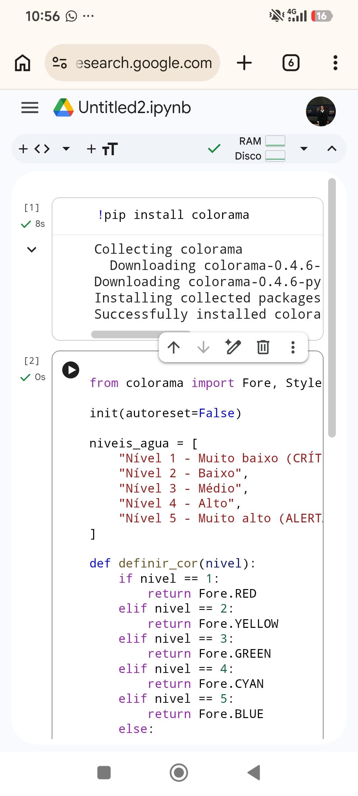
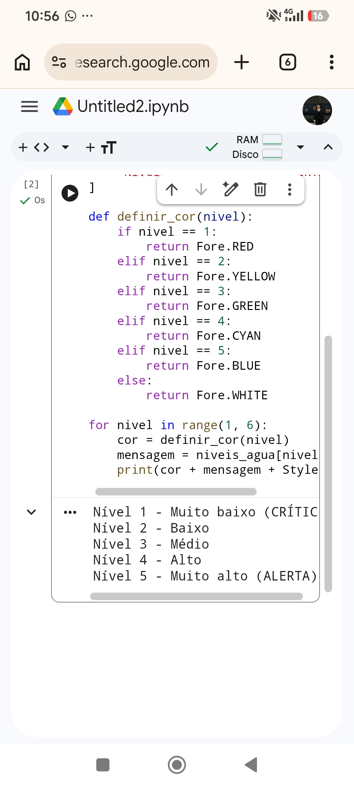

# 💧 Controle de Níveis de Água

## 📌 Sobre o projeto

Este projeto é uma simulação de monitoramento dos níveis de água de um reservatório. O programa exibe mensagens de acordo com o nível identificado, utilizando cores para facilitar a visualização da situação.

## 🎯 Objetivo

Praticar conceitos básicos de Python, como listas, funções, estruturas condicionais, repetição e utilização de bibliotecas.

## 🛠️ Tecnologias utilizadas

- Python
- Biblioteca Colorama
- Google Colab para testar o código

## 🎨 Níveis do reservatório

| Nível | Situação | Cor |
|---|---|---|
| 1 | Muito baixo (CRÍTICO) | Vermelho |
| 2 | Baixo | Amarelo |
| 3 | Médio | Verde |
| 4 | Alto | Ciano |
| 5 | Muito alto (ALERTA) | Azul |

## ▶️ Como executar

Instale a biblioteca Colorama:

```bash
python -m pip install colorama
```

Depois, execute o arquivo:

```bash
python controle_niveis_agua.py
```


## 🧪 Teste do projeto

O programa foi executado no Google Colab após a instalação da biblioteca Colorama. O teste exibiu as cinco mensagens correspondentes aos níveis do reservatório.

### Instalação da biblioteca



### Execução do programa



